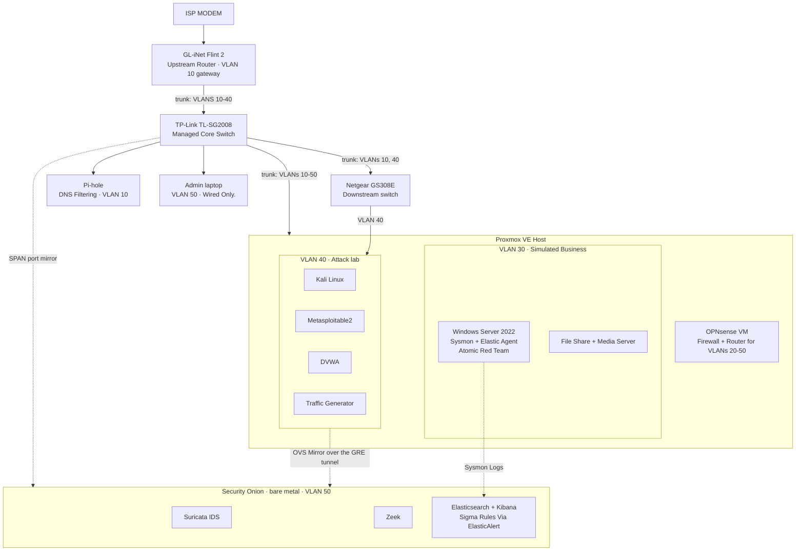

# Lab Architecture

How the lab is wired, segmented, and monitored.

## Network Segmentation

<!-- Each VLAN is on its own network. OPNsense decides what can talk to what. -->

| VLAN | Name | Subnet | What lives there | Gateway |
|------|------|--------|------------------|---------|
| 10 | Personal | 192.168.10.0/24 | Home Devices, Pi-hole, switch and hypervisor management | Flint 2 |
| 20 | Guest | 192.168.20.0/24 | Guest Wi-Fi | OPNsense |
| 30 | Simulated Business | 192.168.30.0/24 | Windows Server Endpoint, file and media server | OPNsense |
| 40 | Attack Lab | 192.168.40.0/24 | Kali, Metasploitable2, DVWA, Traffic Generator | Opnsense |
| 50 | Management | 192.168.50.0/24 | Admin Laptop (Wired-only), Security Onion | OPNsense |

<!-- Rules that make the segmentation real, not just labels. -->

**Isolation Rules**
- Guest cannot reach any internal VLAN.
- Management reaches the lab VLANs only through narrow SSH and web allow rules; everything else is blocked by default.
- The attack lab is kept separate intentionally so vulnerable machines never sit next to personal devices.

## How monitoring works
<!-- Two kinds of visibility: Network (what crosses the wire) and host (What happens inside the machine). --> 
| Source | What it captures | Analyzed by|
|--------|------------------|------------|
| Switch SPAN mirror | Traffic crossing the physical switch | Suricata (alerts), Zeek (connection, DNS, HTTP logs) |
| Open vSwicth Mirror over GRE | VM-To-VM Traffic inside the attack lab, which never touches the physical switch | Suricata, Zeek |
| Sysmon + Elastic Agent | Process creation, registry changes, account changes on the Windows endpoint | Custom Sigma rules via ElastAlert |

<!-- The loop every detection in this repo goes through. -->
**Detection Workflow**
1. Run an Atomic Red Team test mapped to MITRE ATT&CK Technique.
2. Confirm the activity shows up in the logs.
3. Write or adjust the rule, then confirm it alerts.
4. Run a test's cleanup and confirm it does **not** alert (This is how false positives get caught)
5. Document the result in `detections/` and `writeups/`
